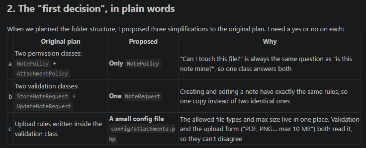
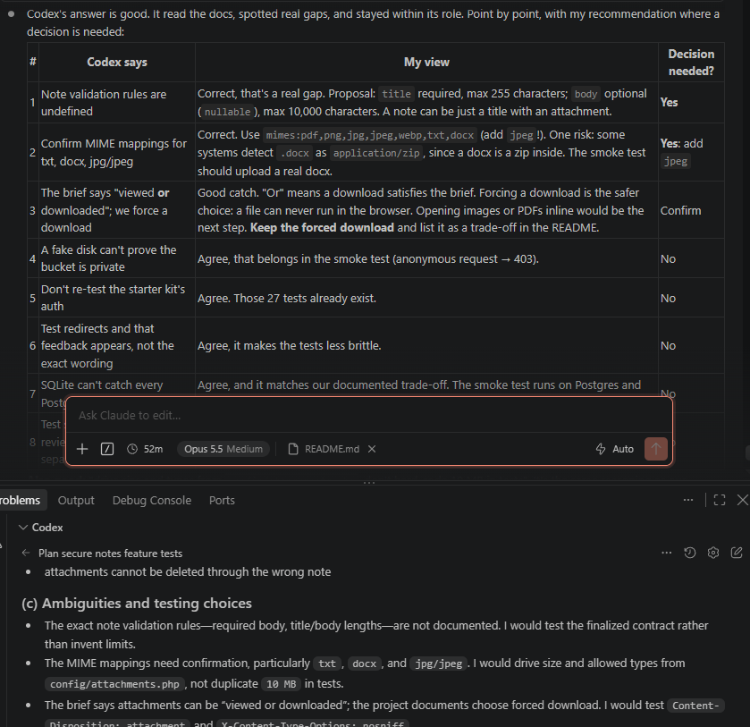
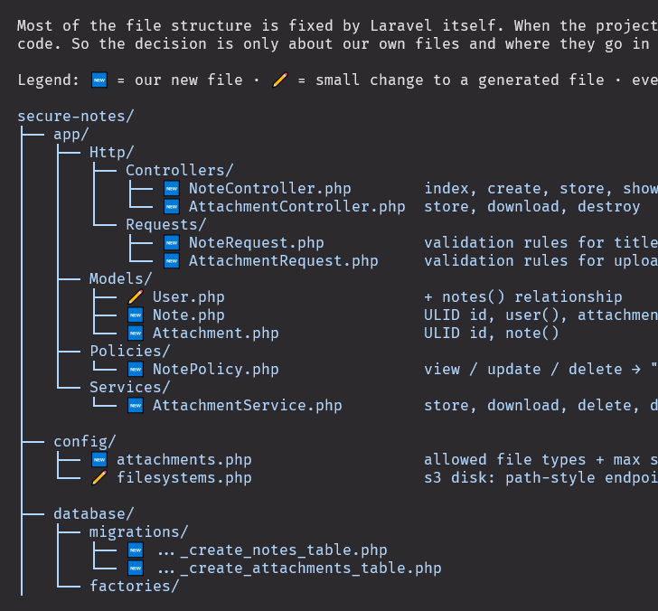

# Secure Notes

A small, secure web application where users create and manage private notes with file attachments.

**Stack:** PHP 8.3 · Laravel 12 (Livewire starter kit for auth, Blade for the app) · PostgreSQL 16 · S3-compatible storage (RustFS) · Tailwind CSS · Pest

## Contents

- [Overview](#overview)
- [How to run](#how-to-run)
- [Architecture](#architecture)
- [Data model](#data-model)
- [Security](#security)
- [Testing](#testing)
- [AI collaboration](#ai-collaboration)
- [Next steps / not done](#next-steps--not-done)
- [Workflow journal](#workflow-journal)

---

## Overview

This guide is made to show how I would explain my decisions in person. I go step by step.

I often stick to this planning pattern when building something, to be able to explain my decisions to managers and to improve cooperation with co-workers. That way a bug or design flaw can be caught and discussed early in the development process. I try to save time and avoid unnecessary back-and-forths.

In a real work scenario I would not write such a big README. Here I try to give as much insight into my workflow as possible, feeling this is the most honest approach.

The README is split in two parts:

- **Reference** (the sections below): what the app is and how it works.
- **[Workflow journal](#workflow-journal)**: how I got there, in chronological order.

This guide is mostly written by hand as the project progresses; I think it is worth the time investment.

**Time:** environment setup, planning and the empty skeleton (Steps 1–4 and the preparation part of Step 5) were prepared beforehand. The 2-hour clock starts at the skeleton commit and covers implementation, tests, review and docs. _TODO: actual time spent within the clock._

---

## How to run

### Prerequisites

- PHP 8.3 with the `pdo_pgsql` extension
- Composer 2
- Node.js 20.19+ (I use 22 LTS)
- PostgreSQL 16 (an empty database and a user that owns it)
- Any S3-compatible storage with a **private** bucket (I use RustFS; AWS S3 works with the same code)

> My own setup: WampServer 3.4.0 on Windows (PHP 8.3.28), PostgreSQL 16 as a Windows service, RustFS 1.0.4 bound to `127.0.0.1`.
> The step-by-step commands I used are in [`bootstrap-process.md`](bootstrap-process.md).

### Steps

```bash
git clone <repo-url> secure-notes
cd secure-notes

composer install
npm install

cp .env.example .env          # PowerShell: copy .env.example .env
php artisan key:generate
```

Fill in `.env`:

```dotenv
DB_CONNECTION=pgsql
DB_HOST=127.0.0.1
DB_PORT=5432
DB_DATABASE=secure_notes
DB_USERNAME=secure_notes
DB_PASSWORD=<your-db-password>

AWS_ACCESS_KEY_ID=<your-s3-access-key>
AWS_SECRET_ACCESS_KEY=<your-s3-secret-key>
AWS_DEFAULT_REGION=us-east-1
AWS_BUCKET=secure-notes
AWS_ENDPOINT=http://127.0.0.1:9000
AWS_USE_PATH_STYLE_ENDPOINT=true

MAIL_MAILER=log
```

Then:

```bash
php artisan migrate
composer run dev              # app on http://127.0.0.1:8000
```

Make sure the S3 storage is running before uploading (for RustFS: `C:\rustfs\start-rustfs.bat`).

### Run the tests

```bash
php artisan test
```

Tests use SQLite in memory and a fake S3 disk, so they need no database or storage running.

---

## Architecture

Every request follows the same path:

```
Route (auth) → FormRequest (validate) → Policy (authorize) → Controller → Service → Model / S3 → Response
```

- **Controllers are thin.** They connect the pieces and return a response; no business logic.
- **FormRequests** (`NoteRequest`, `AttachmentRequest`) hold all input validation.
- **`NotePolicy`** is the single source of truth for ownership. It answers "may I touch this note?" and therefore also "may I touch this attachment?", because an attachment belongs to exactly one note.
- **`AttachmentService`** (constructor-injected) owns everything that touches file storage: store, download, delete. Controllers never call `Storage` directly.
- **`config/attachments.php`** holds the allowed file types and max size, used by both validation and the upload form, so they can never disagree.

**Deliberately not added:** a repository layer. Eloquent already is the data-access abstraction; another layer would add code without adding value at this size.

**Storage abstraction in practice:** the app talks to Laravel's `s3` disk, not to a specific vendor. When MinIO stopped publishing binaries, switching to RustFS was a configuration change only. Moving to AWS S3 would be the same.

The full file structure, with the responsibility of each file and the route table, is in [`docs/file-structure.md`](docs/file-structure.md).
The flow chart is in [`docs/project-flow.canvas`](docs/project-flow.canvas) (Obsidian). _TODO: export it as `docs/assets/project-flow.png` and embed it here, since GitHub cannot display `.canvas` files._

---

## Data model

```
users        id, name, email, password, timestamps              (from the starter kit)
notes        id (ULID), user_id → users (cascade), title, body, timestamps
attachments  id (ULID), note_id → notes (cascade), disk, path,
             original_name, mime_type, size, timestamps
```

- A user has many notes; a note has many attachments. Deleting a note deletes its attachments.
- **ULIDs instead of auto-increment IDs**, so URLs cannot be guessed (`/notes/01JBX7K3M9...` instead of `/notes/57`).
- **Attachments have no `user_id`.** Ownership flows through the note, so there is one source of truth.
- **The original filename is stored only as data**, never used as the storage path.

---

## Security

| Measure | Why |
|---|---|
| Starter-kit authentication (hashed passwords, session regeneration, login rate limiting, CSRF) | Security-critical auth code is not hand-rolled |
| `NotePolicy` + every query scoped to the logged-in user | Users can only see and change their own notes and attachments |
| **404, not 403**, for other users' resources | Does not reveal that a resource exists |
| Scoped route bindings (`/notes/{note}/attachments/{attachment}`) | An attachment can only be reached through the note it belongs to |
| ULIDs in URLs | No ID enumeration; defense in depth on top of the policy |
| FormRequest validation on every input | Invalid data never reaches the controller |
| Upload allowlist (pdf, png, jpg, jpeg, webp, txt, docx), max 10 MB, checked by real MIME type | SVG/HTML are blocked because they can carry scripts (XSS) |
| Note validation: title required (max 255), body optional (max 10,000) | Bounded input; a note can be just a title with attachments |
| Random storage path, client filename never used as a path | Prevents path traversal and overwriting other files |
| Private bucket, downloads only through the app | Every download passes the policy; no public file URLs exist |
| `Content-Disposition: attachment` + `X-Content-Type-Options: nosniff` | The browser downloads files instead of executing them |
| Note bodies rendered as escaped plain text (`{{ }}`) | No stored XSS through note content |
| Separate, non-admin database user | Least privilege: the app cannot touch anything outside its own database |
| Storage bound to `127.0.0.1` | Not reachable from other machines on the network |
| App served from `public/` only (`composer run dev`) | `.env`, source code and logs are never web-accessible |
| Error pages without stack traces (`APP_DEBUG=false` outside development) | No internal details leak to users |

---

## Testing

Feature tests with **Pest**, on **SQLite in memory**, with `Storage::fake('s3')`.

**Covered:**

- guests are redirected to login;
- user A gets 404 on user B's notes and attachments;
- note create / read / update / delete;
- uploads: valid file stored; oversized file and disallowed type rejected;
- deleting a note or an attachment removes the stored file.

**Trade-off:** SQLite is not PostgreSQL (e.g. `LIKE` case sensitivity, looser types). It keeps the tests fast and runnable right after cloning. In a real project I would run the suite against PostgreSQL in CI.

_TODO: final test count and result._

---

## AI collaboration

| Who | Role in this project |
|---|---|
| **Claude Code** | Planning, environment setup (with explicit permission), file structure, proposing implementation in small chunks |
| **Codex** | Writing tests independently from the spec; smoke/canary testing; security review of the implementation |
| **Me** | Delegating tasks, reviewing every chunk, resolving disagreements between agents, owning the final quality |

- **Agents do not write code into the project by default.** They present code in small chunks; I review it and add it.
- **Explicit, scoped permission is the exception.** When it saves time, I allow an agent to write, naming the exact task. The permission does not carry over to the next task.
- Details, permissions granted, and issues caught in review: [`AI_COLLABORATION.md`](AI_COLLABORATION.md). _TODO: add the issues caught during implementation and Codex's security review._

---

## Next steps / not done

- **Email verification:** mail is logged, not sent. I would need to choose an SMTP setup (e.g. Mailpit locally); too much for 2 hours.
- **Presigned S3 URLs** for direct downloads of large files.
- **Inline viewing** of images and PDFs. The brief allows "viewed or downloaded"; I chose forced download because a file can then never run in the browser.
- **Background job** to clean up orphaned files (a file can remain if an S3 delete fails after the database delete).
- **Virus scanning** of uploads.
- **CI pipeline** running the tests against PostgreSQL.
- _TODO: anything unfinished at the 2-hour mark._

---

# Workflow journal

## Step 1: Organizing the agents, workflow and cooperation

**This step usually takes no time; it took me about 5 minutes.**

This is mostly how the collaboration looks, in early steps:


---


I usually work with opencode and Codex. I use the "plan" functionality of opencode with the subscription-based, more expensive model, and rarely use the "build" functionality with the cheap or free models. Free/cheap agents build, smart and expensive agents only plan.

For this project I'm jumping back into Claude Code, older versions of which I have tried before; claude now also has the "plan/build" separation, so I think I'm missing out, this project is a good excuse to jump back in. I use Claude for planning and Codex for tests and smoke/canary testing, which I find it does well. I decided not to use Opencode at this point, maybe I will at step 7.

I have an `AGENTS.md` boilerplate used in most projects. It states that agents are never allowed to edit any file, and that they answer my questions in a specific manner: mostly code, short answers, human-readable code only, and discussing a bug fix first instead of jumping straight to code.

That way I can be sure to never blindly copy-paste or vibe code, and I also don't need to press "allow" every few seconds. I also define keywords I use when I need an agent to actually go ahead and edit files.

I did not create any new Codex/Claude skills, but I would normally consider it. For this project I will probably use a custom-made Codex skill that checks for changes on the Obsidian canvas (see Step 2) and verifies that the README is not missing anything. That skill runs a Node.js script to save tokens.

## Step 2: Obsidian canvas, a quick drawing

I use [Obsidian](https://obsidian.md/) to create a canvas, to wireframe a flow chart for the application: the project roadmap, the request flow of a secure download, and the data model. See [`docs/project-flow.canvas`](docs/project-flow.canvas).

## Step 3: Choosing the tech stack, installing dev dependencies

- **WampServer 3.4.0** with PHP 8.3: already in daily use; I only enabled the PostgreSQL drivers.
- **PostgreSQL 16**: the brief's preferred database. It runs on port 5432, next to my existing MySQL, without conflicts.
- **RustFS** for S3-compatible storage. _MinIO was the first choice, but it stopped publishing free binaries in 2025 (its download now returns `410 Gone`)._ Because the code only talks to the `s3` disk, the switch cost nothing.
- **Composer**, pointed at WAMP's PHP 8.3.
- **Node 22 LTS on Windows** (nvm-windows). Kept on Windows next to PHP, because Node packages installed from WSL do not run on Windows.
- **Not served by Apache.** Serving the project as `localhost/secure-notes` would expose `.env`; `composer run dev` serves only `public/`.
- **`MAIL_MAILER=log`**: password-reset mails are written to `storage/logs` instead of sent.
- **Laravel 12 + Livewire starter kit, for authentication only.** It gives tested register / login / logout / password reset / rate limiting / CSRF out of the box. I don't hand-roll security-critical auth code.
- **Blade + controllers for my own pages** (notes and attachments). Blade is Laravel's server-side templating: the server sends finished HTML, with no separate JS app. Classic controllers keep the request → validation → authorization → response flow explicit and easy to explain. Livewire is only used by the generated auth screens.
- **No front-end framework** for my pages. This is an MVP built in 2 hours that will never see production; a framework would add complexity without adding value.
- **Tailwind CSS** (bundled with the kit). It is enough for a clean, consistent UI at this size.
- **Flash messages** for user feedback.
- **Pest** for testing: Laravel's default, concise syntax.

## Step 4: Deciding on a folder structure

Most of the structure is generated by Laravel; I only decided where my own files go. Full tree and routes: [`docs/file-structure.md`](docs/file-structure.md).



## Step 5: Cutting the assignment into smaller tasks

**Preparation (before the 2-hour clock):** environment setup (Steps 1–4), the project `AGENTS.md`, and an empty skeleton with every class and method from [`docs/file-structure.md`](docs/file-structure.md) but no logic. The skeleton commit marks where the clock starts.

**Within the 2 hours:**

| # | Task | Who |
|---|---|---|
| 1 | Migrations, `Note` / `Attachment` models, relationships, factories | Claude proposes in chunks, I review and add |
| 2 | Notes: `NotePolicy`, `NoteRequest`, `NoteController`, views, flash messages | Claude proposes, I add |
| 3 | Attachments: `config/attachments.php`, `AttachmentRequest`, `AttachmentService`, controller, upload form | Claude proposes, I add |
| ∥ | Feature tests, written **in parallel** from the spec, not from my code | Codex |
| 4 | Run the tests and fix failures; security review of the finished code | Codex reviews, I decide what gets fixed |
| 5 | README, `AI_COLLABORATION.md`, final commit | Me |

**Why Codex writes the tests in parallel:** the tests come from the requirements and not from the implementation, so they check what the app *should* do rather than repeating what I wrote. If Codex and Claude disagree, I decide.

**If time runs short,** I cut from the bottom: styling polish first, then UI niceties. Authorization and its tests are never cut.

**Commits:** setup + skeleton → models → notes → attachments → tests → review fixes → docs.

## Step 6: Building a skeleton app

_TODO_

## Step 7: Implementation

_TODO_
